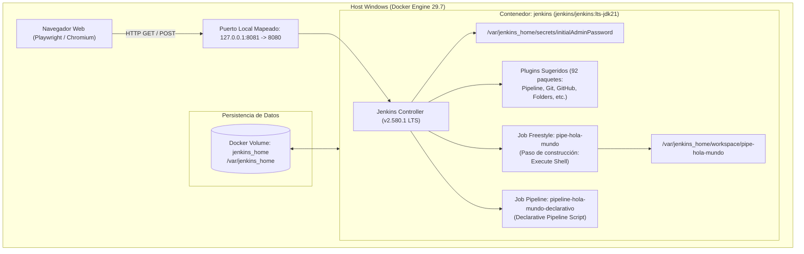

# Laboratorios de Jenkins — CI/CD Automation

[](https://www.jenkins.io/)
[](https://www.docker.com/)
[](https://openjdk.org/)
[](https://utvt.edomex.gob.mx/)
[](https://github.com/LudwinGarcia1)

Repositorio de prácticas de **Integración Continua y Entrega Continua (CI/CD)** utilizando **Jenkins** contenedorizado en Docker, correspondiente a la asignatura **Evaluación y Mejora para el Desarrollo de Software** en la **Universidad Tecnológica del Valle de Toluca (UTVT)**.

---

## 📌 Datos Institucionales

* **Institución:** Universidad Tecnológica del Valle de Toluca (UTVT)
* **Carrera:** Ingeniería en Desarrollo y Gestión de Software (IDGS)
* **Grupo:** IDGS-81
* **Asignatura:** Evaluación y Mejora para el Desarrollo de Software
* **Docente:** Mtro. Jorge Almeida Montiel
* **Alumno:** Ludwin García Gaytán
* **Matrícula:** `222310777`
* **Correo Institucional:** `al222310777@utvtol.edu.mx`
* **Práctica:** Asignación 11 — Jenkins (Laboratorio 1)

---

## 🏗️ Arquitectura de la Práctica (Lab 1)



---

## 🚀 Estructura del Repositorio

```text
jenkins-laboratories/
├── .gitignore
├── README.md
├── Lab 1/
│   ├── Comandos inciales.txt       # Comandos base oficiales de la práctica
│   ├── docker-compose.yml          # Orquestación con Docker Compose
│   ├── Jenkinsfile                 # Definición de Pipeline as Code (Declarative)
│   ├── pipe-hola-mundo.xml         # Exportación XML del job Freestyle
│   ├── start-jenkins.ps1           # Script de despliegue automatizado en PowerShell
│   └── start-jenkins.sh            # Script de despliegue automatizado en Bash
└── docs/
    ├── Reporte_Practica11_Jenkins.docx   # Reporte formal de evidencias académicas UTVT
    └── evidencias/                       # Capturas y terminales en alta resolución
        ├── term_01_docker_run.png
        ├── term_02_admin_password.png
        ├── term_03_console_output.png
        ├── 01_unlock_screen_initial.png
        ├── 02_unlock_screen_filled.png
        ├── 05_first_user_screen.png
        ├── 06_first_user_filled.png
        ├── 07_instance_config.png
        ├── 08_jenkins_ready.png
        ├── 09_dashboard_final_jobs.png
        ├── 10_new_job_page.png
        ├── 11_new_job_configured.png
        ├── 14_build_step_shell.png
        ├── 15_job_overview.png
        ├── 17_console_output_build1.png
        └── 19_pipeline_console_output.png
```

---

## ⚙️ Instrucciones de Despliegue y Ejecución

### 1. Requisitos Previos

* Docker Desktop o Docker Engine $\ge 24.0$ instalado y activo.
* Git $\ge 2.40$
* Navegador Web moderno (Chrome, Edge, Firefox).

### 2. Creación del Volumen y Contenedor

Ejecutar en PowerShell:

```powershell
# Crear el volumen administrado para persistencia de datos
docker volume create jenkins_home

# Desplegar el contenedor de Jenkins en segundo plano (puerto 8081)
docker run -d --name jenkins --restart unless-stopped -p 127.0.0.1:8081:8080 -v jenkins_home:/var/jenkins_home jenkins/jenkins:lts-jdk21
```

O alternativamente usando Docker Compose:

```powershell
cd "Lab 1"
docker compose up -d
```

### 3. Obtención de la Contraseña Inicial

```powershell
docker exec jenkins cat /var/jenkins_home/secrets/initialAdminPassword
```

### 4. Configuración en la Interfaz Web

1. Acceder a `http://127.0.0.1:8081`.
2. Pegar la clave obtenida en la pantalla **Unlock Jenkins**.
3. Seleccionar **Install suggested plugins**.
4. Crear el usuario administrador principal:
   * **Usuario:** `ludwin`
   * **Nombre completo:** `Ludwin Garcia Gaytan`
   * **Correo electrónico:** `ludwin.garcia@grupoaov.com`
5. Confirmar la URL de la instancia: `http://127.0.0.1:8081/`.
6. Finalizar la configuración y acceder al panel de control.

### 5. Creación del Trabajo `pipe-hola-mundo`

1. En el panel principal, seleccionar **Nueva tarea** (New Item).
2. Nombre de la tarea: `pipe-hola-mundo`.
3. Seleccionar **Crear un proyecto de estilo libre** (Freestyle project) y presionar **OK**.
4. En la pestaña **Pasos de compilación** (Build Steps), seleccionar **Añadir un paso de compilación** $\rightarrow$ **Ejecutar línea de comandos (shell)**.
5. Introducir el comando:
   ```bash
   echo "=========================================================="
   echo "  UNIVERSIDAD TECNOLOGICA DEL VALLE DE TOLUCA"
   echo "  Materia: Evaluacion y Mejora para el Desarrollo de Software"
   echo "  Practica 11: Jenkins - Laboratorio 1"
   echo "  Alumno: Ludwin Garcia Gaytan | Matricula: 222310777"
   echo "  Grupo: IDGS-81 | Profesor: Jorge Almeida Montiel"
   echo "=========================================================="
   echo "!Hola mundo!"
   ```
6. Presionar **Guardar** (Save).
7. Hacer clic en **Construir ahora** (Build Now).
8. Abrir la compilación **#1** y consultar **Salida de la consola** (Console Output), verificando el estado `Finished: SUCCESS`.

---

## 📊 Salida de Consola Verificada (Build #1)

```text
Started by user Ludwin Garcia Gaytan
Running as SYSTEM
Building in workspace /var/jenkins_home/workspace/pipe-hola-mundo
[pipe-hola-mundo] $ /bin/sh -xe /tmp/jenkins9332486992868625625.sh
+ echo ==========================================================
==========================================================
+ echo   UNIVERSIDAD TECNOLOGICA DEL VALLE DE TOLUCA
  UNIVERSIDAD TECNOLOGICA DEL VALLE DE TOLUCA
+ echo   Materia: Evaluacion y Mejora para el Desarrollo de Software
  Materia: Evaluacion y Mejora para el Desarrollo de Software
+ echo   Practica 11: Jenkins - Laboratorio 1
  Practica 11: Jenkins - Laboratorio 1
+ echo   Alumno: Ludwin Garcia Gaytan | Matricula: 222310777
  Alumno: Ludwin Garcia Gaytan | Matricula: 222310777
+ echo   Grupo: IDGS-81 | Profesor: Jorge Almeida Montiel
  Grupo: IDGS-81 | Profesor: Jorge Almeida Montiel
+ echo ==========================================================
==========================================================
+ echo !Hola mundo!
!Hola mundo!
Finished: SUCCESS
```

---

## 📄 Entregables

1. **Código fuente:** Repositorio en GitHub [`LudwinGarcia1/jenkins-laboratories`](https://github.com/LudwinGarcia1/jenkins-laboratories).
2. **Reporte de evidencias:** Documento en formato Word [`docs/Reporte_Practica11_Jenkins.docx`](docs/Reporte_Practica11_Jenkins.docx) y respaldo en la carpeta personal de documentos.
